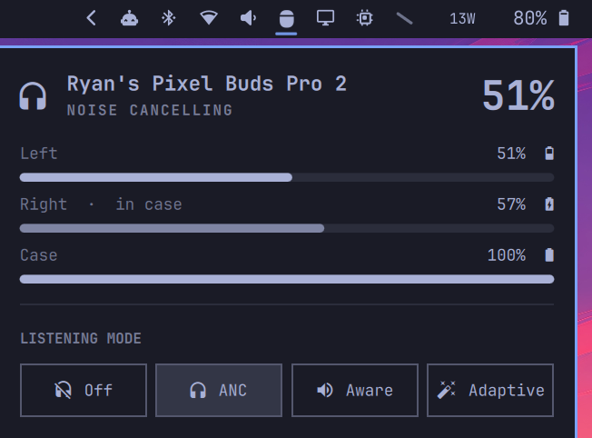

# Pixel Buds for Omarchy

Pixel Buds battery and listening-mode control, right in the Omarchy bar.
Omarchy-native: everything it needs ships with a stock Omarchy install, so
there is nothing else to install or build.



## What's new in 2.0.3

- **Works on Omarchy 4.0.5 (Qt 6.12).** Qt 6.12 adds its own `Color` type,
  which hid the shell palette from the plugin, so its fallback colors came
  out black. The plugin now reads the palette as `Commons.Color`, as
  Omarchy's shell docs require; it still works on Omarchy 4.0.4 (Qt 6.11).

## What's new in 2.0.2

- **Native Bluetooth events.** Connects and disconnects now come from the
  shell's built-in Bluetooth client instead of a separate `gdbus monitor`
  process, so the plugin runs one process fewer and parses no BlueZ output.
- **Bounded under load.** Updates pushed by the buds reach the bar at most
  four times a second and only when something changed, the case level is
  saved at most every 30 seconds, the volume OSD is shown once for all bars,
  and a flapping Bluetooth connection restarts the bridge at most every 3 s.
- **Listening-mode switches** no longer get cleared by the reply to an older
  request when you switch twice quickly.

## What's new in 2.0.1

- **Buds that were already connected now show up.** Some Pixel Buds Pro 2
  stay connected without BlueZ ever marking their services ready, and 2.0
  waited for them forever. The icon now appears at shell start and on
  connect for those pairs too.
- **MIT licence only**, taking pbpctrl's MIT option for the protocol port.

## What's new in 2.0

2.0 rewrites how the plugin talks to the buds. Earlier versions drove the
`pbpctrl` command-line tool (from the AUR), starting a new process and a new
Bluetooth connection for every reading. 2.0 speaks the buds' protocol itself
through a small bundled Python bridge that keeps one connection open while the
buds are connected, so the buds push battery and setting changes as they
happen.

- **No pbpctrl needed.** It is no longer used; you can uninstall it if nothing
  else needs it.
- **New EQ section**: the 5-band EQ, balance, volume EQ and mono audio now
  have their own collapsible section.
- **Mouse-over hints** explain every EQ and Advanced control.
- **Phone-only controls removed**: on-head detection, volume level alerts and
  the Assistant hold only work with the Pixel Buds app on a phone, so they no
  longer appear in the panel.
- **Renamed buds are found**: detection uses the buds' Maestro service, not
  their Bluetooth name.

Upgrading from 1.x:

```bash
omarchy plugin update io.github.rdoupe.pixelbuds
omarchy restart shell
```

## Features

- **Per-bud and case battery** with charging and in-case state. The case only
  reports while a bud is docked (it has no radio of its own), so the last
  reading is cached and shown with a "last seen" age — same trick Android uses.
- **Listening-mode panel**: Off / Noise Cancelling / Transparency, plus
  Adaptive on Pixel Buds Pro 2 (or any pair that reports the Adaptive mode);
  clickable or keyboard-navigable.
- **Quick ANC cycling**: right- or middle-click the bar icon to cycle modes
  without opening the panel, following the same mode loop configured on the
  buds themselves.
- **Shared volume and swipe OSD**: shows the buds' native Bluetooth absolute
  volume and summons Omarchy's volume OSD when either bud changes it.
- **Device toggles**: multipoint audio and speech detection (auto-transparency
  while you talk). Rows are capability-gated — a control only appears if your
  buds answer for it. Phone-only features (on-head detection, volume level
  alerts, the Assistant hold) are left to the Pixel Buds app: on a computer
  they have no effect.
- **Touch controls**: enable/disable gestures, set each bud's hold to ANC
  (a hold set to Assistant from a phone can be moved back), and select the
  listening modes that hold cycles.
- **EQ**, a collapsed section of its own: the 5-band EQ, balance,
  volume-dependent EQ and mono audio. Device toggles and touch controls live
  in the collapsed **Advanced** section below it.
- **Low battery** turns a battery row the urgent color at 20% or less.
- **Event-driven**: follows BlueZ through the shell's own Bluetooth client, so the icon
  appears within about a second of the buds connecting; battery and mode
  changes are pushed by the buds over one long-lived session, and while
  they're disconnected the plugin polls nothing at all.

The bar icon is the closed charging case, drawn to the proportions of the real
thing.

## Requirements

Nothing beyond a standard Omarchy install. Everything below is already part
of Omarchy's base packages:

- `python3` with its PyGObject (`python-gobject`) bindings and BlueZ, both
  part of Omarchy's base packages.
- Pixel Buds that expose Google's Maestro service (Pixel Buds Pro and Pixel
  Buds Pro 2).

No AUR package, no build step, no separately installed helper. The plugin
never installs software and never elevates privileges.

## Install

```bash
omarchy plugin add https://github.com/rdoupe/omarchy-pixelbuds.git --enable
```

## Remove

```bash
omarchy plugin remove io.github.rdoupe.pixelbuds
```

Outside the plugin directory the plugin writes only the cached case-battery
reading at `${XDG_STATE_HOME:-~/.local/state}/omarchy-pixelbuds/case` and a
session lock file under `$XDG_RUNTIME_DIR/omarchy-pixelbuds/`; both can be
deleted freely.

## Settings

| Setting | Default | Meaning |
|---------|---------|---------|
| `pollIntervalSec` | 30 | Fallback refresh interval while connected; the buds push changes as they happen (the panel refreshes faster while open) |
| `hideWhenDisconnected` | true | Hide the bar icon entirely while no Pixel Buds are connected; set false to keep a dimmed icon |

Configure via the bar widget settings or directly in
`~/.config/omarchy/shell.json`.

## IPC

The widget exposes the IPC target `io.github.rdoupe.pixelbuds` with methods `open`,
`close`, `toggle`, `showAdvanced`, `refresh`, `cycleAnc`, and `setAnc(mode)` where mode is one
of `off`, `active`, `aware`, `adaptive`:

```bash
omarchy-shell io.github.rdoupe.pixelbuds cycleAnc
omarchy-shell io.github.rdoupe.pixelbuds setAnc aware
```

Handy for keybindings.

## How it works

The buds' settings live behind Google's proprietary **Maestro** protocol: a
Pigweed `pw_rpc` service with protobuf messages, carried in HDLC frames over
an RFCOMM channel advertised under the vendor UUID
`25e97ff7-24ce-4c4c-8951-f764a708f7b5`. The plugin speaks it directly with a
bundled, standard-library Python bridge (`bridge/`), a port of the protocol
layer of [pbpctrl](https://github.com/qzed/pbpctrl).

- `Service.qml` is a single shell-wide service, so there is exactly one bridge
  and one Maestro session however many monitors show the widget. It follows
  connects and disconnects through the shell's own BlueZ client
  (`Quickshell.Bluetooth`, the same one Omarchy's Bluetooth panel uses), so
  the plugin reads no BlueZ output of its own.
- On a connect event it starts `/usr/bin/python3 -I -B bridge/pixelbuds_bridge.py`.
  The bridge picks the connected device that advertises the Maestro UUID,
  never by name: a renamed pair is still found, and a headset that is merely
  named "Pixel Buds" is not. (A paired device that advertises the Maestro
  UUID itself is treated as buds; everything it sends is bounded and
  validated before it reaches the bar.) The bridge talks to the device only
  while BlueZ reports it `Connected`; a pair whose `ServicesResolved` stays
  false gets a short settle window first. It registers a client-role BlueZ
  `Profile1` for the Maestro UUID and calls `Device1.ConnectProfile`; BlueZ does the SDP lookup
  and hands over the RFCOMM socket. That is the same path pbpctrl uses.
- The bridge holds that one session while the buds stay connected: it reads
  the initial state, subscribes to the buds' runtime-info (battery,
  placement) and settings-change streams so updates are pushed, and serves
  the widget's commands one at a time over line-delimited JSON on
  stdin/stdout. Refreshes and mode switches therefore cost one RPC round trip
  instead of a new process and a new RFCOMM connection.
- It stands down immediately, closing the socket from its D-Bus thread, when
  the buds disconnect (`Connected` or `ServicesResolved` turns false), when
  BlueZ asks the profile to disconnect, when bluetoothd restarts, or when the
  widget closes its stdin or terminates it. The widget also stops it on the
  BlueZ disconnect signal. The plugin never re-establishes a link to a device
  that is going away.

Hardening: every byte from the buds is bounded before it is buffered (4 KiB
per HDLC frame, bounded protobuf varints, field counts and lengths) and every
value is validated (percentages 0–100, enums allow-listed, EQ bands finite and
within ±6 dB, names capped at 100 characters); every RPC has a timeout. JSON
lines in both directions are size-capped and strictly validated, and the QML
validates the bridge's output a second time and renders every text as
`Text.PlainText`. Processes are launched by absolute path with argv arrays
and a closed, allow-listed environment (`clearEnvironment`,
`PATH=/usr/bin:/bin`); no shell is involved anywhere, and the Python bridge
starts no processes and opens no network sockets. The session lock and the
case cache are opened through verified, no-follow directory descriptors, with
type and owner checks (and, for the lock, a link-count check) on the opened
file itself.

## Testing

`tests/run-tests.sh` runs the offline suite: protocol codec tests (using
pbpctrl's own test vectors), the bridge against a simulated pair of buds over
a socketpair (every read and write, push updates, malformed and hostile
device input, disconnects mid-operation, stdin EOF), lock and cache
hardening, an end-to-end run of the real bridge against a fake BlueZ on a
private `dbus-daemon`, and the launch-boundary contract. None of it needs
Bluetooth hardware or touches the system bus.

`tests/hardware-smoke.py --yes-real-hardware [--write]` exercises a real,
connected pair: read-only by default, `--write` adds one listening-mode round
trip that restores the original mode.

## Credits

The Maestro protocol layer in `bridge/maestro.py` is ported from
[pbpctrl](https://github.com/qzed/pbpctrl) by Maximilian Luz (used under its MIT option); see
[NOTICE](NOTICE). [pixelbuds-plugin-kde](https://github.com/thek0d3r/pixelbuds-plugin-kde)
served as an independent cross-check of the protocol; no code was taken from
it.

## License

[MIT](LICENSE). `bridge/maestro.py` and the test vectors marked "(pbpctrl)"
are derived from pbpctrl, Copyright (c) 2022 Maximilian Luz, used under its MIT
option; see [NOTICE](NOTICE).
